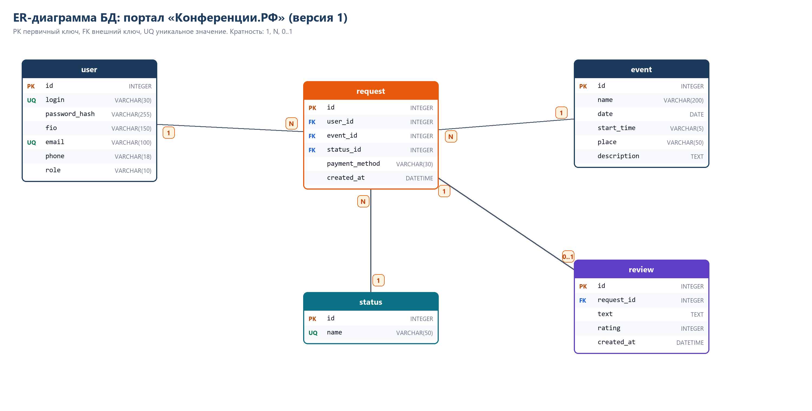

# Практика 2. Проектирование базы данных, ER-диаграмма

Что сделал:

1. Выделил сущности: пользователь, мероприятие, заявка, статус, отзыв.
2. Описал поля и типы данных (таблица ниже).
3. Определил первичные и внешние ключи.
4. Нарисовал ER-диаграмму (`er_diagram_v1.png`) и сохранил в папку проекта.
5. Написал скрипт `schema_v1.sql` (он же лежит в `database/migrations/001_init.sql`) и проверил, что он создаёт БД без ошибок. Скриншот терминала: `терминал_создание_БД.png`.

## Таблицы

| Таблица | Поля |
|---------|------|
| user | id (PK), login (UNIQUE), password_hash, fio, email (UNIQUE), phone, role (user/admin) |
| status | id (PK), name (UNIQUE): Новая, Мероприятие назначено, Завершено |
| event | id (PK), name, date, start_time, place, description |
| request | id (PK), user_id (FK), event_id (FK), status_id (FK), payment_method, created_at |
| review | id (PK), request_id (FK, UNIQUE), text, rating (1-5), created_at |

## Связи

- один пользователь может подать много заявок: user 1 : N request;
- одно мероприятие описано в заявке: event 1 : N request (по факту у нас 1 : 1, но так проще расширять);
- один статус у многих заявок: status 1 : N request;
- на одну заявку один отзыв: request 1 : 0..1 review (за это отвечает UNIQUE на request_id).

Отношения «многие ко многим» у меня нет. Если бы у заявки было несколько помещений, понадобилась бы промежуточная таблица.

## Проверки в самой БД

- `CHECK (role IN ('user','admin'))`;
- `CHECK (rating BETWEEN 1 AND 5)`;
- `CHECK (length(text) BETWEEN 1 AND 2000)`;
- внешние ключи работают только с `PRAGMA foreign_keys = ON`, поэтому включаю его при каждом подключении в `backend/db.py`.

В практике 12 схема дорабатывается (справочники помещений и оплаты, журнал статусов), см. `er_diagram_v2.png` там.
