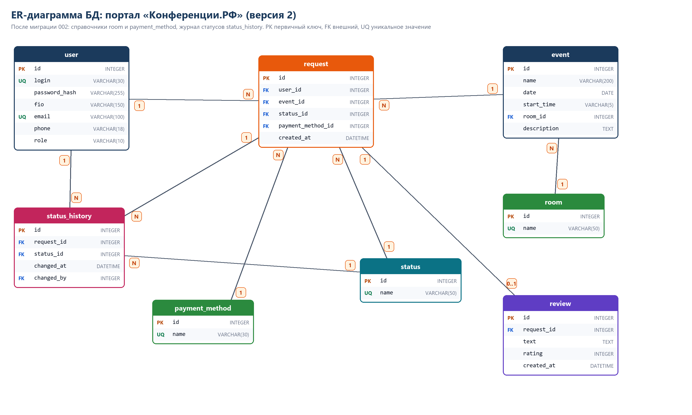

# Практика 12. Доработка структуры БД

## Зачем дорабатывал

В версии 1 помещение и способ оплаты хранились обычным текстом (`event.place`, `request.payment_method`). Из-за этого в списках приходилось дублировать значения в коде и можно было записать опечатку. Историю смены статусов тоже нигде не хранили, видно было только текущий статус. Поэтому в версии 2:

1. Добавлены **справочники** `room` (помещения) и `payment_method` (способы оплаты). Теперь из таблицы строятся выпадающие списки, а в `event` и `request` лежат ссылки `room_id` и `payment_method_id`.
2. Добавлена таблица **`status_history`** (журнал статусов заявок): какая заявка, какой статус, когда и кто поменял.
3. Таблицы **отзывов** (`review`) и **статусов** (`status`) уже были, теперь они связаны с журналом и проверяются на целостность.

## Миграция данных

Файл `database/migrations/002_dictionaries.sql`:

1. создаются новые таблицы;
2. значения из старых текстовых колонок переносятся в справочники (`INSERT OR IGNORE ... SELECT DISTINCT`);
3. в `event` и `request` добавляются колонки-ссылки, и они заполняются по названию;
4. для каждой существующей заявки в журнал пишется запись с её текущим статусом;
5. старые текстовые колонки удаляются;
6. добавлены индексы на новые внешние ключи.

Чтобы проверить на реальных данных, написал `tools/make_v1_demo.py` (создаёт БД версии 1 с пользователями, заявками и отзывами) и `tools/check_db.py` (считает записи и проверяет ссылки).

## Скриншоты

- `01_база_версии_1_с_данными.png`: БД версии 1, таблицы `user`, `event`, `request`, `review`, `status`, текстовые поля `place`.
- `02_миграция_и_проверка_целостности.png`: применилась миграция 002, количество записей сохранилось (5 заявок, 2 отзыва), в журнале 5 записей, `foreign_key_check` и `integrity_check` без нарушений, пустых ссылок нет.
- `03_данные_после_миграции.png`: запрос с `JOIN` по новым справочникам возвращает те же заявки, что были до миграции.
- `er_diagram_v2.png`: обновлённая ER-диаграмма.

## Проверка целостности связей

- `PRAGMA foreign_keys = ON` включается при каждом подключении;
- `status_history.request_id` с `ON DELETE CASCADE`: при удалении заявки журнал чистится сам;
- в коде удаление заявки идёт в одной транзакции (отзыв, заявка, мероприятие без заявок), это покрыто тестом `test_admin_delete_removes_everything`.
